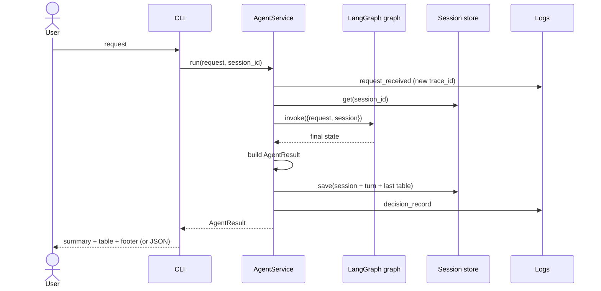
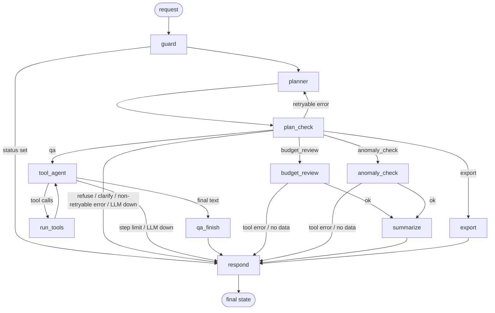
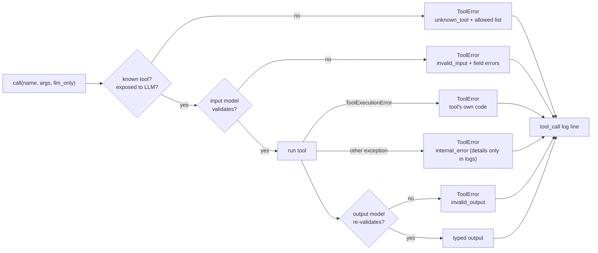
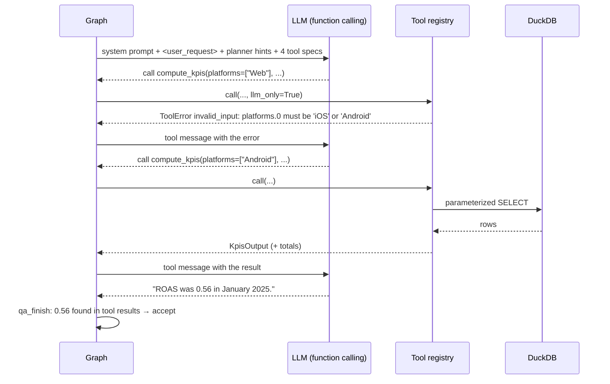
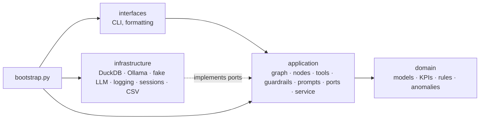

# Architecture

Detailed design of the App Portfolio Analytics Agent. For the business case, setup and results, see the [README](../README.md).

## Contents

1. [Request lifecycle](#1-request-lifecycle)
2. [Graph nodes](#2-graph-nodes)
3. [State](#3-state)
4. [Planning and the plan check](#4-planning-and-the-plan-check)
5. [Tools and contracts](#5-tools-and-contracts)
6. [Q&A tool-calling loop](#6-qa-tool-calling-loop)
7. [Fixed workflows](#7-fixed-workflows)
8. [Answer verification](#8-answer-verification)
9. [Output contract](#9-output-contract)
10. [Error handling](#10-error-handling)
11. [Observability](#11-observability)
12. [Layers and dependencies](#12-layers-and-dependencies)
13. [Configuration](#13-configuration)

---

## 1. Request lifecycle



`AgentService.run()` is the single entry point. It opens a trace (a `trace_id` stored in a context variable, so concurrent requests never mix), runs the graph, converts the final state into an `AgentResult`, updates the session and logs a decision record. Any unexpected exception is caught and returned as `status: error` with a fixed message; details go to the logs only.

## 2. Graph nodes



| Node | Kind | Responsibility |
|---|---|---|
| `guard` | code | Normalizes text (NFKC, strips control characters) and refuses empty, over-long, prompt-injection and write/delete requests |
| `planner` | LLM | Produces a `Plan` via structured output (`ask_structured`: JSON schema + validation + retry with the validation errors) |
| `plan_check` | code | Refusal and clarification routing, `normalize_plan`, retry decision |
| `tool_agent` | LLM | One function-calling step; stops at `max_tool_steps` |
| `run_tools` | code | Executes up to `max_tool_calls_per_step` calls through the registry with `llm_only=True`, appends tool messages, collects facts and the latest table |
| `qa_finish` | code | Accepts the final answer only if every number is supported by tool results; otherwise falls back to the verified table |
| `budget_review` | code | `compute_kpis` → `apply_budget_rules` → facts, template summary, decisions table |
| `anomaly_check` | code | `compute_kpis` for the period and the previous equal-length period → `detect_anomalies` |
| `summarize` | LLM | Rewrites the facts as prose; kept only if the number check passes |
| `export` | code | `export_csv` of the session's last table |
| `respond` | code | Fills defaults so every run ends with a status and a summary |

Conditional routing is driven by state: a node that sets `status` ends the run (it routes to `respond`).

## 3. State

`AgentState` is a `TypedDict`. `tool_calls` and `warnings` use an `operator.add` reducer, so every node appends to them instead of overwriting.

| Field | Set by | Purpose |
|---|---|---|
| `request` | service, `guard` | User text (cleaned by the guard) |
| `session` | service | Earlier turns and last result table |
| `plan`, `plan_attempts`, `plan_feedback` | `planner`, `plan_check` | Current plan, retry counter, error fed back to the planner |
| `workflow` | `plan_check` | Validated route |
| `agent_messages`, `tool_steps`, `answer` | `tool_agent`, `run_tools` | Q&A conversation with the LLM |
| `facts` | workflows, `run_tools` | Structured data the summary or answer must be grounded in |
| `data`, `table` | workflows | Payload and table returned to the caller |
| `summary`, `status` | any node | Final text and outcome |
| `tool_calls`, `warnings` | any node | Audit trail (appended) |

Sessions (`Session`) keep the last `session_max_turns` turns (request, workflow, status, short summary) and the last result table. The planner sees the last `session_history_turns` turns inside `<previous_turns>`.

## 4. Planning and the plan check

The planner returns:

```json
{
  "workflow": "qa | budget_review | anomaly_check | export | refuse | clarify",
  "period": "none | last_7_days | last_14_days | last_30_days | last_month | last_quarter | custom",
  "start": "YYYY-MM-DD or null",
  "end": "YYYY-MM-DD or null",
  "apps": ["..."], "platforms": ["..."], "countries": ["..."],
  "reason": "one sentence"
}
```

The LLM only names the period; **code resolves it** against the last day of data ("today" = 2025-01-31), so "last week" is always 2025-01-25 to 2025-01-31. `Plan` also accepts common small-model mistakes: a single string instead of a list, a JSON-encoded list, or an empty string for a date.

`normalize_plan` then:

| Check | On failure |
|---|---|
| Names exist (case-insensitive, normalized to canonical spelling) | **Retryable**: error sent back to the planner, up to `llm_max_retries` |
| `custom` period has both dates; start ≤ end | Retryable |
| Period inside the data range | **Not retryable**: clarification. A retry once led the model to silently answer for a different year |
| Anomaly check has an earlier period to compare with | Not retryable: clarification |
| Defaults: budget review → last full month; anomaly check → last `anomaly_default_days` days; Q&A → no period (the tool agent decides) | n/a |

`refuse` returns a fixed refusal text (the model's own wording is never shown). `clarify` returns the model's question, neutralized and truncated.

## 5. Tools and contracts

Each tool is a `Tool(name, description, input_model, output_model, func, llm_exposed)` registered in `ToolRegistry`. Every call goes through `ToolRegistry.call()`:



The same Pydantic input model generates the function-calling schema the LLM sees (`llm_tool_specs()`), so the description and the enforcement can't drift apart. Errors go back to the LLM as JSON (`{"error": {"code": "unknown_value", "message": "...", "details": {"allowed": [...]}}}`) so it can correct its next call.

| Tool | LLM | Input | Output | Notable checks / error codes |
|---|---|---|---|---|
| `get_schema` | ✅ | none | `SchemaOutput`: columns, allowed values, date range, KPI formulas | n/a |
| `run_sql` | ✅ | `RunSqlInput{sql}` | `RunSqlOutput`: SQL actually run, rows, `truncated` | SQL guard codes: `not_select`, `multiple_statements`, `table_not_allowed`, `function_not_allowed`, `ratio_aggregation`, `sql_too_long`, `parse_error`; `query_failed` |
| `fetch_metrics` | ✅ | `MetricsQuery{start, end, apps?, platforms?, countries?}` | `MetricsOutput`: rows per pair + `totals` | `unknown_value` (with allowed list), `period_out_of_range` (with available range) |
| `compute_kpis` | ✅ | `KpiQuery` = `MetricsQuery` + `group_by?` (`app`, `platform`, `country`) | `KpisOutput`: `KpiRow` per pair, or `GroupTotals` per group, + `totals` | as above; no NaN or infinity |
| `apply_budget_rules` | ❌ | `BudgetRulesInput{kpis}` | `DecisionsOutput`: decisions + counts | counts must match decisions |
| `detect_anomalies` | ❌ | `AnomalyInput{previous, current}` | `AnomaliesOutput` | both periods non-empty |
| `export_csv` | ❌ | `ExportInput{columns, rows, filename?}` | `ExportResult{path, row_count}` | filename `[A-Za-z0-9_-]{1,64}`, path stays in the export folder, formula cells escaped |

`fetch_metrics` and `compute_kpis` return deterministic **totals** over the rows they fetched, and `compute_kpis` can **group** by app, platform or country. Before these existed, the 4B model regularly added rows up incorrectly; now it only quotes numbers.

### SQL guard

`validate_select` parses with sqlglot (DuckDB dialect) and allows exactly one `Query` node. It rejects any write/DDL/session node anywhere in the tree (`INSERT`, `UPDATE`, `DELETE`, `MERGE`, `DROP`, `CREATE`, `ALTER`, `TRUNCATE`, `COPY`, `SET`, `PRAGMA`, `ATTACH`, `DETACH`, `USE`, `INSTALL`, `EXPORT`, `DESCRIBE`, `INTO`), `SUM`/`AVG` over a division (`ratio_aggregation`: KPIs must be total over total; the error tells the model to divide the sums or use `compute_kpis`), table functions, schema-qualified names, tables other than `app_metrics` (CTE names allowed), and functions starting with `read_`, `write_`, `glob`, `getenv`, `query`, and similar. It adds or lowers the `LIMIT`. The repository is a second layer: DuckDB is opened `read_only` with `enable_external_access=false` and `lock_configuration=true`.

## 6. Q&A tool-calling loop



Limits: `max_tool_steps` tool calls per question, `max_tool_calls_per_step` per LLM turn, tool results truncated to `max_tool_result_chars` for the LLM. The prompt steers the model to `compute_kpis` with `group_by` for comparisons and to `run_sql` only for breakdowns the tools can't give (by month or day).

## 7. Fixed workflows

**Budget review.** `compute_kpis` for the plan's period and filters, then `apply_budget_rules` with thresholds from settings:

| Rule | Condition | Action |
|---|---|---|
| `no_spend` | ROAS undefined (no spend) | maintain |
| `roas_below_cut_threshold` | ROAS < `budget_cut_roas_below` (0.8) | cut |
| `roas_within_target_range` | 0.8 ≤ ROAS < `budget_scale_roas_at_least` (1.5) | maintain |
| `spend_too_low_to_scale` | ROAS ≥ 1.5 but spend < `budget_scale_min_spend` ($1,000) | maintain |
| `roas_above_scale_threshold` | ROAS ≥ 1.5 and spend ≥ $1,000 | scale |

Decisions are sorted cuts first, then scales, then maintains, largest absolute profit first. The facts passed to the summary contain totals, counts and `top_cuts` / `top_scales` (the largest `summary_top_n`).

**Anomaly check.** KPIs for the period and the equal-length previous period (`Period.previous()`), then `detect_anomalies`: for each pair with spend ≥ `anomaly_min_spend` in either period, flag each metric in `anomaly_metrics` that changed by at least `anomaly_min_change_pct`, sorted by size.

## 8. Answer verification

`unsupported_numbers(text, facts)` extracts every number from the LLM's text and requires each one to match a value in the facts:

- `$1,234.56`, `12.5%`, `$77K`, `$1.2M` and number words (`two` … `twenty`) are understood.
- A quoted number matches a value if it equals the value **rounded or truncated** at the precision shown, either as is or ×100 (for percentages). `379,754` and `379,755` match 379,754.68; `37` doesn't match 38.
- ISO and written dates, years, `0` and `1`, and "top 3" style phrases are ignored.
- List lengths count as facts ("5 apps"), except lists named `top_*`, which are samples ("top 5 scales" is not "5 scales").

If anything is unsupported, the LLM text is discarded: the budget review and anomaly check keep their deterministic template summary, and Q&A shows the verified table with a note. A `summary_fallback` or `answer_rejected` warning records which numbers failed.

## 9. Output contract

`AgentResult` has the same shape for every outcome:

| Field | Content |
|---|---|
| `trace_id`, `session_id` | Correlation with logs and the conversation |
| `workflow` | `qa`, `budget_review`, `anomaly_check`, `export` or null (refused / clarification before routing) |
| `status` | `ok`, `refused`, `needs_clarification`, `error` |
| `summary` | Human-readable text (verified LLM text or deterministic template) |
| `data` | Workflow payload: budget/anomaly facts, export path, tools used |
| `table` | Columns, rows and source of the result table (exportable) |
| `plan` | The validated plan |
| `tool_calls` | Tool, ok, duration, error code for every call |
| `warnings` | Guard, plan-retry, fallback and limit events |
| `duration_ms` | End-to-end time |

## 10. Error handling

| Situation | Behaviour | Status |
|---|---|---|
| Injection, write request, empty or long input | Fixed message, no LLM call | `refused` |
| Off-topic request | Fixed refusal text | `refused` |
| Vague request | Model's clarifying question | `needs_clarification` |
| Unknown app/country, bad dates | Planner retried with the error, then clarification | `ok` or `needs_clarification` |
| Period outside data / nothing to compare with | Clarification without retry | `needs_clarification` |
| Invalid planner JSON | `ask_structured` retries with validation errors | `ok` or `error` |
| Invalid tool arguments from the LLM | Structured error back to the LLM, which retries | `ok` |
| Tool loop doesn't converge | Stops at `max_tool_steps` | `error` |
| Unverifiable numbers | Template summary or verified table | `ok` + warning |
| Export with nothing to export | Asks the user to run a query first | `needs_clarification` |
| Ollama down or timing out | Fixed message | `error` |
| Unexpected exception | Fixed message, stack trace in logs | `error` |

## 11. Observability

- **Structured logs**: one line per event on stderr, JSON by default (`ts`, `level`, `logger`, `event`, `trace_id`, fields). Events: `request_received`, `llm_call` (model, duration, prompt/output tokens, tool calls), `tool_call` (tool, args, duration, ok, error code, output size), `llm_invalid_output`, `agent_crashed`, and a final `decision_record` (workflow, status, plan, tools, warnings, duration).
- **Redaction**: fields named `*_token`, `*_secret`, `*_password`, `*_api_key` are masked; long values truncated (`log_max_value_chars`).
- **CLI footer** `[status · workflow · N tool calls · seconds · trace <id>]`, and `--verbose` for live logs.
- **LangSmith** (optional): with `LANGSMITH_API_KEY` set, each request is one run named `portfolio-agent` with `trace_id` and `session_id` in its metadata (searchable by the id in the CLI footer). LangGraph traces every node; the Ollama adapter is `@traceable(run_type="llm")` (prompt, answer, token usage, model metadata) and the tool registry is `@traceable(run_type="tool")` (one `tool:<name>` run per call with arguments, output or error). With no key, tracing is off and `traceable` is a no-op.

## 12. Layers and dependencies



Dependencies point inward. Ports in `application/ports.py`: `MetricsRepository`, `LLMClient`, `Exporter`, `SessionStore`. The application depends on LangGraph directly (it *is* the orchestration logic); everything else external sits behind a port. Prompts are versioned `.md` files in `application/prompts/`, rendered with `string.Template`.

## 13. Configuration

All settings come from environment variables or `.env` (`AGENT_` prefix; LangSmith keeps its usual names) and are validated by `pydantic-settings` at start-up. A test fails if any setting is missing from `.env.example`.

| Group | Settings |
|---|---|
| Paths | `DB_PATH`, `EXPORT_DIR` |
| Sample data | `SEED`, `SEED_START`, `SEED_END` |
| LLM | `LLM_PROVIDER`, `OLLAMA_BASE_URL`, `OLLAMA_MODEL`, `OLLAMA_THINK`, `LLM_TEMPERATURE`, `LLM_TIMEOUT_S`, `LLM_MAX_RETRIES` |
| Limits | `MAX_INPUT_CHARS`, `MAX_SQL_CHARS`, `SQL_ROW_LIMIT`, `MAX_TOOL_STEPS`, `MAX_TOOL_CALLS_PER_STEP`, `MAX_TOOL_RESULT_CHARS` |
| Business rules | `BUDGET_CUT_ROAS_BELOW`, `BUDGET_SCALE_ROAS_AT_LEAST`, `BUDGET_SCALE_MIN_SPEND`, `ANOMALY_MIN_CHANGE_PCT`, `ANOMALY_MIN_SPEND`, `ANOMALY_DEFAULT_DAYS`, `ANOMALY_METRICS` |
| Summaries | `LLM_SUMMARIES`, `MAX_SUMMARY_CHARS`, `SUMMARY_TOP_N`, `SUMMARY_MAX_ANOMALIES` |
| Sessions | `SESSION_MAX_TURNS`, `SESSION_HISTORY_TURNS`, `SESSION_MAX_SESSIONS` |
| Output and logs | `DISPLAY_MAX_ROWS`, `LOG_LEVEL`, `LOG_FORMAT`, `LOG_MAX_VALUE_CHARS`, `LANGSMITH_API_KEY`, `LANGSMITH_PROJECT` |

Kept in code on purpose: the allowed SQL table (part of the schema and the SQL guard), KPI formulas (business definitions), the synthetic data's realism constants, and the LangGraph recursion limit (derived from `MAX_TOOL_STEPS`).
